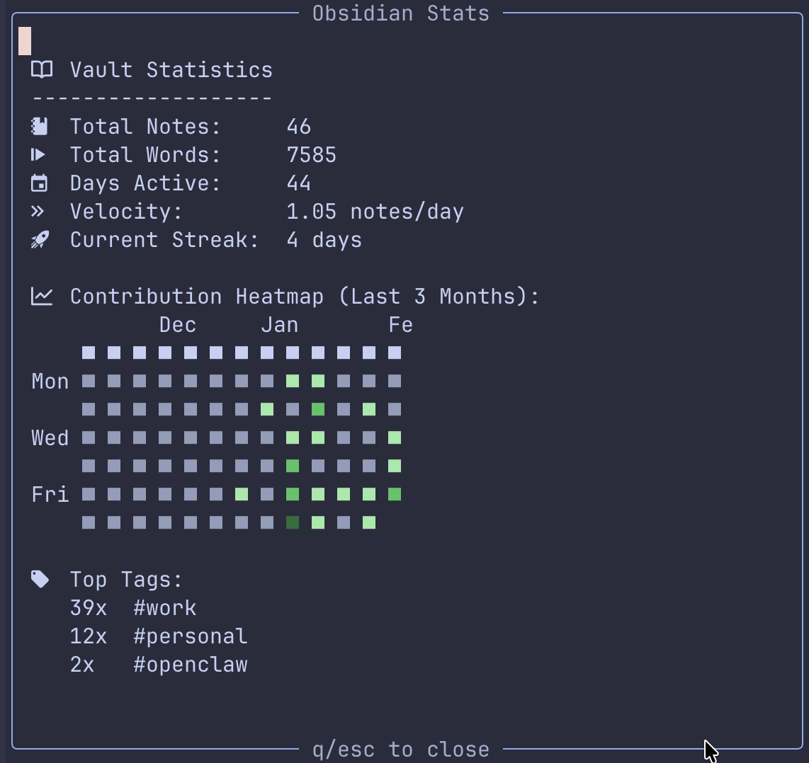

# obsidian-stats.nvim

A simple Neovim plugin to display statistics for your Obsidian vault.



## Features

- Total Notes count
- Total Word count
- Days Active (inclusive calendar days since the oldest note)
- Velocity (notes per day)
- Current Writing Streak
- Contribution Heatmap (last 3, 6, 9 months, or year)
- Top 3 Tags

## Requirements

- Neovim >= 0.8.0
- macOS or Linux
- [fd](https://github.com/sharkdp/fd) (`fd` or Debian/Ubuntu’s `fdfind`)
- [nui.nvim](https://github.com/MunifTanjim/nui.nvim) (see installation below)

## Installation

### lazy.nvim

```lua
{
  "damianpoole/obsidian-stats.nvim",
  cmd = "ObsidianStats",
  dependencies = {
    "MunifTanjim/nui.nvim",
  },
  opts = {
    vault_path = "~/vaults/second-brain", -- Update this path
  },
}
```

## Usage

Run the command:

```vim
:ObsidianStats
```

## Configuration

Default configuration:

```lua
require("obsidian-stats").setup({
  vault_path = "~/vaults/second-brain",
  heatmap = {
    range = "3_months", -- or "6_months", "9_months", "1_year"
    activity = "modified", -- or "created" or "both"
  },
  sections = {
    weekly_chart = true, -- legacy toggle for the heatmap
    -- heatmap = true, -- optional explicit toggle (overrides weekly_chart)
  },
})
```

## How statistics are collected

The vault is scanned in the background. Re-running `:ObsidianStats` replaces a
pending scan and refreshes the popup. `fd` discovers Markdown files using its
normal hidden-file and ignore rules; all statistics, including tags, are computed
from those same notes. Attachments and other non-Markdown files do not contribute.
Vault paths and filenames are passed literally, including spaces and quotes.

Neovim's filesystem API supplies timestamps on both macOS and Linux; no shell,
BSD `stat`, `wc`, `awk`, or `rg` pipelines are used. Where a filesystem does not
provide a positive creation timestamp, modification time is used instead. Unix
change time (`ctime`) is never treated as creation time.

- Words are whitespace-separated tokens, using Lua's whitespace classification.
- Tags retain the existing `#[a-zA-Z0-9_-]+` pattern. The top three sort by count,
  with alphabetical order breaking ties.
- Days active counts local calendar days inclusively, with a minimum of one.
- Streaks use distinct modification dates and may end today or yesterday.
- Heatmaps use current creation/modification timestamps, not a revision history.
  In `both` mode a note contributes once per date, even when both timestamps fall
  on the same day. Local calendar dates handle daylight-saving changes.

Files are read in chunks with at most eight notes being read concurrently. Notes
that disappear or cannot be read during a scan are skipped, with a warning. The
popup reports the readable notes from that scan.

## Development

Run the headless tests from the repository root with Neovim and `fd` installed:

```sh
TZ=Europe/London nvim --headless -u NONE -i NONE -n -c "lua dofile('tests/run.lua')"
```

The tests create temporary vaults and do not read your real notes. They cover
literal paths, ignored files, chunked reads, timestamp fallback, scan errors and
cancellation, calendar boundaries, and popup rendering. The popup dependency is
stubbed in these tests; the normal plugin still requires `nui.nvim`.
